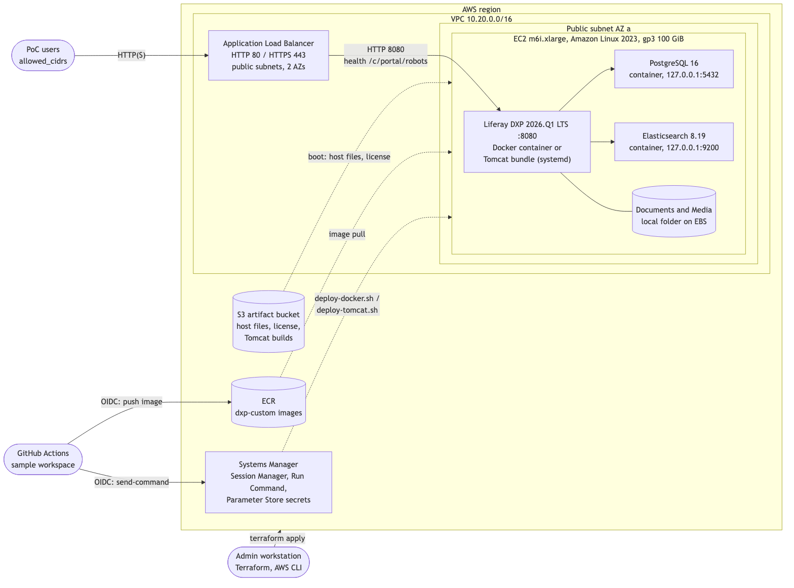
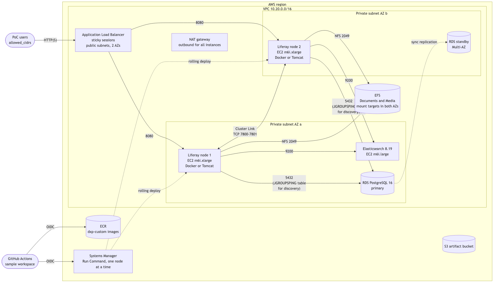

# Liferay DXP Self-Hosted on Amazon EC2: Step-by-Step Guide

**Product:** Liferay DXP 2026.Q1 LTS (`2026.q1.13-lts`), self-hosted on Amazon EC2, deployed with Docker (or the traditional Tomcat bundle)
**Audience:** Partner and customer technical teams setting up a sandbox or proof-of-concept (PoC) environment
**Prepared by:** Liferay Customer Success APAC
**Status:** Draft, October 2026. Not yet applied to a real AWS account. The Terraform passes `terraform validate`, every shell script passes ShellCheck, and the sample workspace's build and `linux/amd64` image jobs passed in GitHub Actions on 22 October 2026 ([run 39708712711](https://github.com/LGSAPAC/lfrgs-sh-aws-ec2-sample-workspace/actions/runs/39708712711)). Items to confirm are marked **🔎 Verify**.

> ⚠️ **Read this first: this is a planning draft, not a tested runbook.**
> This guide builds Liferay on plain EC2 instances: no Kubernetes, no EKS, no Helm. It combines Liferay's documented self-hosted installation (Docker image and Tomcat bundle, Cluster Link, remote Elasticsearch) with common AWS practice (Terraform, Application Load Balancer, RDS, EFS, Systems Manager, GitHub OIDC). AWS console labels and instance types change; follow AWS documentation where it differs from this guide.

> ⚠️ **Handle credentials with care.** This guide uses placeholders such as `<region>`, `<stack>` and `<account-id>`. Generated passwords live in SSM Parameter Store and in the Terraform state; nothing secret is committed. Never paste access keys, passwords or license files into documents, slides, chat, tickets or Git.

---

## Repository layout

The step-by-step guide below is the source of truth; the files implement it. Terraform copies everything under `host/` to `/opt/liferay-ec2` on each instance at boot.

| File | Used in | Purpose |
| --- | --- | --- |
| `scripts/check-aws-access.sh` | Section 4.4 | Read-only check that your AWS credentials reach every service the guide uses |
| `terraform/` | Sections 5, 6 | VPC, security groups, ALB, EC2, RDS, EFS, S3, ECR, SSM parameters, IAM and the GitHub OIDC role |
| `terraform/terraform.tfvars.example` | Section 5 | Every option: single or high availability, Docker or Tomcat, versions, sizes |
| `terraform/templates/user-data.sh.tftpl` | Section 7 | EC2 user data: writes `/etc/liferay-ec2/host.env`, copies `host/` from S3, runs the bootstrap |
| `license/README.md` | Section 2.3 | Where to put your activation key locally (never committed) |
| `host/scripts/bootstrap.sh` | Section 7 | Installs Docker and Compose, mounts EFS, renders config, starts the stack |
| `host/scripts/render-config.sh` | Section 7 | Writes `portal-ext.properties`, the Elasticsearch OSGi config, JGroups files and the license from host settings and SSM secrets |
| `host/docker/compose.yaml` | Sections 8, 9 | Liferay, PostgreSQL 16 and Elasticsearch services, picked per instance with Compose profiles |
| `host/docker/elasticsearch/Dockerfile` | Sections 8, 9 | Elasticsearch 8.19 with Liferay's four analysis plugins |
| `host/scripts/install-tomcat-bundle.sh` | Section 8.3 | Tomcat runtime: Amazon Corretto 21, the DXP Tomcat bundle (checksum-verified) and a systemd service |
| `host/systemd/liferay.service` | Section 8.3 | systemd unit for the Tomcat bundle |
| `host/config/jgroups-tcp-jdbc-ping.xml` | Section 9.4 | Cluster Link over TCP with JDBC_PING discovery (no multicast in a VPC) |
| `host/scripts/deploy-docker.sh` | Section 12 | Rolls a node to a new image, waits for it to be ready, rolls back on failure |
| `host/scripts/deploy-tomcat.sh` | Section 12 | Deploys a workspace build into a Tomcat bundle (hot deploy, restart only if configs changed) |
| `host/scripts/verify-node.sh` | Every section | Read-only checks of one instance; prints `PASS` / `FAIL` per check |
| `host/scripts/liferay-log.sh` | Sections 8, 9, 12 | Prints the Liferay log for either runtime (`-f` to follow) |
| `scripts/run-on-stack.sh` | Every section | Runs a command on the stack's instances through SSM and prints each output |
| `scripts/verify-deployment.sh` | Section 11 | End-to-end check: load balancer targets, HTTP, and `verify-node.sh` on every instance |
| `docs/architecture-*.mmd` / `.png` | Section 1 | Architecture diagrams (Mermaid source and rendered images) |
| [LGSAPAC/lfrgs-sh-aws-ec2-sample-workspace](https://github.com/LGSAPAC/lfrgs-sh-aws-ec2-sample-workspace) (separate repo) | Section 12 | Liferay Workspace with a sample module and client extension, and GitHub Actions that build, push to ECR and deploy to these instances |

---

## Contents

1. [What you will build](#1-what-you-will-build)
2. [Prerequisites](#2-prerequisites)
3. [Install the command-line tools](#3-install-the-command-line-tools)
4. [Set up AWS access](#4-set-up-aws-access)
5. [Choose your options](#5-choose-your-options)
6. [Provision the infrastructure](#6-provision-the-infrastructure)
7. [How each instance is bootstrapped](#7-how-each-instance-is-bootstrapped)
8. [Single instance: start Liferay](#8-single-instance-start-liferay)
9. [High availability](#9-high-availability)
10. [HTTPS and your own domain](#10-https-and-your-own-domain)
11. [Validate the deployment](#11-validate-the-deployment)
12. [CI/CD with GitHub Actions](#12-cicd-with-github-actions)
13. [Backups, logging and monitoring](#13-backups-logging-and-monitoring)
14. [From PoC to production](#14-from-poc-to-production)
15. [Tear down the environment](#15-tear-down-the-environment)
16. [Troubleshooting](#16-troubleshooting)
17. [Assumptions to verify](#17-assumptions-to-verify)
18. [Reference documentation](#18-reference-documentation)

---

## 1. What you will build

Two deployment modes and two ways to run Liferay, chosen with two Terraform variables. Every combination uses the same scripts, the same configuration and the same CI/CD pipeline.

| | `deployment_mode = "single"` | `deployment_mode = "ha"` |
| --- | --- | --- |
| **Use it for** | Sandbox, demo, first PoC | PoC of the production topology, failover tests |
| **Load balancer** | Application Load Balancer (ALB) | ALB with sticky sessions across 2+ nodes |
| **Liferay DXP** | 1 EC2 instance (`m6i.xlarge`) in a public subnet | 2 or more EC2 instances in private subnets, two Availability Zones, Cluster Link |
| **Database** | PostgreSQL 16 container on the same instance | Amazon RDS for PostgreSQL 16, Multi-AZ |
| **Search** | Elasticsearch 8.19 container on the same instance | Elasticsearch 8.19 on its own EC2 instance |
| **Documents and Media** | Folder on the instance's EBS volume | Amazon EFS, shared by every node |
| **Outbound internet** | Public IP (inbound only from the ALB) | NAT gateway |
| **Secrets** | SSM Parameter Store (SecureString) | Same |
| **Admin access** | SSM Session Manager (no SSH, no open ports) | Same |
| **Rough cost** 🔎 | About USD 250 per month in `ap-southeast-1` | About USD 900 per month |

| | `liferay_runtime = "docker"` (recommended) | `liferay_runtime = "tomcat"` |
| --- | --- | --- |
| **How Liferay runs** | `liferay/dxp:2026.q1.13-lts` container, or your custom image from ECR | DXP Tomcat bundle in `/opt/liferay`, `liferay` systemd service, Amazon Corretto 21 |
| **What CI/CD deploys** | A new image (workspace code baked in), node by node | Module jars and client extension zips into `deploy/` (hot deploy), node by node |
| **Upgrades** | New image tag | New bundle (`liferay_version`), re-run the bootstrap |
| **Choose it when** | You want immutable, repeatable deployments | Your team already operates Tomcat bundles, or policy forbids containers for the application |

In both runtimes PostgreSQL (single mode) and Elasticsearch run as containers with Docker Compose, and every service uses host networking, so Liferay finds them at the same addresses either way.

**Single instance:**



**High availability:**



The diagram sources are in [`docs/`](docs/) (Mermaid). After editing one, re-render it with `npx -y @mermaid-js/mermaid-cli -i docs/architecture-ha.mmd -o docs/architecture-ha.png -b white -s 2`.

**Responsibilities when self-hosting:** Liferay supports the DXP image and bundle. Your team owns the AWS account, network, instances, database, search, storage, TLS, DNS, backups, monitoring, patching and secrets.

**Time required:** about 1 hour for single mode and 1.5 to 2 hours for high availability, most of it waiting for RDS and the first Liferay start.

---

## 2. Prerequisites

### 2.1 AWS account

- An AWS account you may create resources in, with a payment method. A **dedicated sandbox account** (for example from AWS Organizations) is best.
- A **budget alert** (Billing → Budgets) at a figure you are comfortable with, so a forgotten stack can't run up a large bill. Tear down when finished (section 15).
- Default service quotas are enough: 1 VPC, 1 Elastic IP (HA mode), 1 ALB, up to 7 vCPUs of standard instances (single) or about 14 (HA).

### 2.2 Region

Pick one region for everything; this guide uses **Asia Pacific (Singapore), `ap-southeast-1`** in examples. Any commercial region with at least two Availability Zones and `m6i` instances works.

### 2.3 Liferay license

- **A Liferay DXP activation key** (XML). The 2026.Q1 LTS images and bundles ship **no trial license**: without a key Liferay never becomes ready.
- **High availability needs a key that allows clustering.** A single-node developer key is not enough for two nodes. Ask your Liferay representative.
- Copy it to `license/license.xml` (see [`license/README.md`](license/README.md)). It is git-ignored; Terraform uploads it to a private S3 bucket.

### 2.4 GitHub

- Access to create repositories (or use the sample workspace) in your GitHub organization, for the CI/CD in section 12.

### Verify

```bash
ls -l license/license.xml                     # your key is in place
grep -c '<license' license/license.xml         # prints 1 or more
git check-ignore license/license.xml           # prints the path: it will never be committed
```

✅ Expected: the file exists, contains a `<license>` element, and `git check-ignore` prints its path.

---

## 3. Install the command-line tools

| Tool | Version | Purpose |
| --- | --- | --- |
| AWS CLI | v2 | Access check, SSM commands, verification |
| Session Manager plugin | current | Shell on instances without SSH (`aws ssm start-session`) |
| Terraform | 1.9 or later (tested: `terraform validate` with 1.17.0) | Provision everything |
| jq | any | JSON parsing in the scripts |
| GitHub CLI (`gh`) | current | Set the workspace's Actions variables (section 12) |
| Git | any | Clone the repositories |
| JDK 21 | optional | Only to build the sample workspace locally |

### macOS (Homebrew)

```bash
brew install awscli jq gh git
brew install --cask session-manager-plugin
brew tap hashicorp/tap && brew install hashicorp/tap/terraform
```

### Linux / WSL 2

Install the [AWS CLI v2](https://docs.aws.amazon.com/cli/latest/userguide/getting-started-install.html), the [Session Manager plugin](https://docs.aws.amazon.com/systems-manager/latest/userguide/session-manager-working-with-install-plugin.html), [Terraform](https://developer.hashicorp.com/terraform/install), jq and the [GitHub CLI](https://cli.github.com/) from their official packages.

### Verify

```bash
aws --version                  # aws-cli/2.x
session-manager-plugin --version
terraform version              # 1.9 or later
jq --version
gh --version
```

✅ Expected: every command prints a version; none says `command not found`.

---

## 4. Set up AWS access

### 4.1 Secure the root user

Signed in as the account's **root user**: turn on **MFA**, create **no access keys**, and set the budget alert from section 2.1. Use the root user for nothing else.

### 4.2 Create an identity for the PoC

Use **IAM Identity Center** (recommended) or an IAM user:

- **IAM Identity Center:** create a user, assign it to the account with the **`PowerUserAccess`** permission set **plus** an inline policy allowing IAM role and OIDC provider management (Terraform creates the instance role and the GitHub Actions role):

  ```json
  {
    "Version": "2012-10-17",
    "Statement": [{
      "Effect": "Allow",
      "Action": [
        "iam:CreateRole", "iam:DeleteRole", "iam:GetRole", "iam:TagRole", "iam:UntagRole",
        "iam:PutRolePolicy", "iam:GetRolePolicy", "iam:DeleteRolePolicy", "iam:ListRolePolicies",
        "iam:AttachRolePolicy", "iam:DetachRolePolicy", "iam:ListAttachedRolePolicies",
        "iam:CreateInstanceProfile", "iam:DeleteInstanceProfile", "iam:GetInstanceProfile",
        "iam:AddRoleToInstanceProfile", "iam:RemoveRoleFromInstanceProfile", "iam:ListInstanceProfilesForRole",
        "iam:TagInstanceProfile", "iam:PassRole", "iam:ListRoles",
        "iam:CreateOpenIDConnectProvider", "iam:DeleteOpenIDConnectProvider",
        "iam:GetOpenIDConnectProvider", "iam:ListOpenIDConnectProviders", "iam:TagOpenIDConnectProvider"
      ],
      "Resource": "*"
    }]
  }
  ```

- **IAM user (if Identity Center is not available):** same permissions, console access with MFA, and an access key for the CLI stored only in your own `~/.aws/credentials`.
- Avoid `AdministratorAccess` in shared accounts. For production, scope the policy to the resources Terraform manages.

### 4.3 Configure the CLI

Run this in **your own terminal**:

```bash
# IAM Identity Center
aws configure sso --profile liferay-poc
aws sso login --profile liferay-poc

# or, IAM user with an access key
aws configure --profile liferay-poc
```

Then select the profile and region for the whole session:

```bash
export AWS_PROFILE=liferay-poc
export AWS_REGION=ap-southeast-1
```

### 4.4 Verify access

Run the read-only check. It creates nothing and costs nothing:

```bash
scripts/check-aws-access.sh ap-southeast-1
```

✅ Expected: the identity shows your user or role ARN (not `root`), every service shows **OK**, and the last line is `All services reachable`. Note whether a GitHub OIDC provider is listed: if so, set `create_github_oidc_provider = false` in section 5.

| Result | Cause | Fix |
| --- | --- | --- |
| `No valid AWS credentials` / `ExpiredToken` | SSO session expired or wrong profile | `aws sso login --profile liferay-poc`; check `AWS_PROFILE` |
| `AccessDenied` / `UnauthorizedOperation` on one service | Missing permission | Add `PowerUserAccess` and the IAM policy from 4.2 |
| IAM rows fail | `PowerUserAccess` alone excludes IAM | Add the inline IAM policy from 4.2 |
| `Could not connect to the endpoint URL` | Region typo or region not enabled | Check `AWS_REGION`; enable opt-in regions in the account settings |

---

## 5. Choose your options

```bash
cp terraform/terraform.tfvars.example terraform/terraform.tfvars
```

Edit `terraform/terraform.tfvars`. The important settings:

| Variable | Example | Notes |
| --- | --- | --- |
| `region` | `ap-southeast-1` | Same as `AWS_REGION` |
| `name` | `liferay-poc` | Stack name: prefixes resources, tags instances `LiferayStack=<name>`, names SSM parameters `/<name>/...` |
| `deployment_mode` | `single` or `ha` | Section 1 |
| `liferay_runtime` | `docker` or `tomcat` | Section 1 |
| `liferay_version` | `2026.q1.13-lts` | Image tag `liferay/dxp:<version>` and the Tomcat bundle. Latest promoted release in <https://releases.liferay.com/releases.json> |
| `elasticsearch_version` | `8.19.20` | The sidecar version DXP 2026.Q1.13 ships with |
| `allowed_cidrs` | `["203.0.113.10/32"]` | Who can open Liferay. Find your IP with `curl -s https://checkip.amazonaws.com` |
| `license_file` | `../license/license.xml` | Uploaded to S3 by Terraform |
| `github_repository` | `LGSAPAC/lfrgs-sh-aws-ec2-sample-workspace` | Repository allowed to deploy (section 12). Empty skips the CI/CD role |
| `create_github_oidc_provider` | `true` | `false` if the account already has one (section 4.4) |
| `acm_certificate_arn`, `virtual_host` | empty | HTTPS and your own domain, section 10 |
| `liferay_node_count`, `liferay_heap`, `elasticsearch_heap`, `db_instance_class` | `2`, `6g`, `2g`, `db.m6g.large` | HA sizing. With HA, raise `liferay_heap` to `8g` (Liferay has the instance to itself) |
| `force_destroy` | `true` | Lets `terraform destroy` delete the bucket, ECR images and RDS without a final snapshot. **Set to `false` for anything you want to keep** |

> 💡 **Remote state:** Terraform keeps state, including the generated passwords, in `terraform/terraform.tfstate` by default. For a shared PoC, store it in an encrypted, private S3 bucket with a [`backend "s3"`](https://developer.hashicorp.com/terraform/language/backend/s3) block instead, and never commit it (it is in `.gitignore`).

### Verify

```bash
cd terraform
terraform init
terraform validate
terraform plan -out=liferay.tfplan
```

✅ Expected: `Success! The configuration is valid.`, then a plan ending with `Plan: N to add, 0 to change, 0 to destroy.` (about 45 resources in single mode and 60 in HA). Read the plan: the `aws_instance.liferay` count should match your mode, and `aws_s3_object.license[0]` should appear (if it does not, `license_file` was not found).

---

## 6. Provision the infrastructure

```bash
terraform apply liferay.tfplan
```

Single mode takes about 5 minutes; HA takes 15 to 20 minutes, mostly RDS Multi-AZ. Terraform returns once the AWS resources exist; the instances keep bootstrapping for another 10 to 20 minutes (section 7).

What gets created:

| Resource | Single | HA |
| --- | --- | --- |
| VPC, 2 public and 2 private subnets in 2 AZs, internet gateway, S3 gateway endpoint | ✔ | ✔ |
| NAT gateway and Elastic IP | | ✔ |
| Security groups: ALB (80/443 from `allowed_cidrs`), Liferay (8080 from the ALB; 7800-7801 between nodes in HA), search (9200 from Liferay), RDS (5432 from Liferay), EFS (2049 from Liferay) | ✔ | ✔ |
| ALB, target group (health check `/c/portal/robots`, sticky sessions), HTTP listener (HTTPS when a certificate is set) | ✔ | ✔ |
| Liferay EC2 instances (Amazon Linux 2023, IMDSv2 only, encrypted gp3) | 1 | `liferay_node_count` |
| Elasticsearch EC2 instance | | 1 |
| RDS for PostgreSQL 16 Multi-AZ, encrypted, 7-day backups | | ✔ |
| EFS (encrypted, automatic backups) with mount targets in both AZs | | ✔ |
| S3 artifact bucket (private, encrypted, versioned): `host/`, `license/`, `builds/` | ✔ | ✔ |
| ECR repository `<name>/dxp-custom` (scan on push, keeps 20 images) | ✔ | ✔ |
| SSM parameters `/<name>/db/password` and `/<name>/liferay/admin-password` (SecureString, random) | ✔ | ✔ |
| IAM instance role (SSM, ECR read, the bucket, the stack's parameters) | ✔ | ✔ |
| GitHub OIDC provider and the GitHub Actions role (ECR push, `builds/` upload, SSM Run Command on this stack's instances only) | ✔ | ✔ |

### Verify

```bash
terraform output
```

✅ Expected: `liferay_url`, `liferay_instance_ids`, `artifact_bucket`, `ecr_repository_url`, `github_actions_role_arn` and `license_uploaded = true`. In HA mode also `db_endpoint` (an `rds.amazonaws.com` name), `efs_id` and `search_instance_id`.

✅ Every instance is running and registered with Systems Manager (this can take 2 to 3 minutes after the apply):

```bash
STACK=$(terraform output -raw stack_name)

aws ec2 describe-instances \
  --filters "Name=tag:LiferayStack,Values=${STACK}" "Name=instance-state-name,Values=running" \
  --query 'Reservations[].Instances[].[Tags[?Key==`Name`]|[0].Value, InstanceId, PrivateIpAddress, Placement.AvailabilityZone]' \
  --output table

aws ssm describe-instance-information \
  --filters "Key=tag:LiferayStack,Values=${STACK}" \
  --query 'InstanceInformationList[].[InstanceId, PingStatus, PlatformName]' --output table
```

Every instance shows `Online` and `Amazon Linux`. In HA mode, the Liferay nodes are in **two different** Availability Zones.

✅ The host files and license reached S3:

```bash
aws s3 ls "s3://$(terraform output -raw artifact_bucket)/" --recursive | grep -E 'host/scripts/bootstrap.sh|license/license.xml'
```

✅ HA only: RDS is Multi-AZ and EFS is available:

```bash
aws rds describe-db-instances --db-instance-identifier "${STACK}" \
  --query 'DBInstances[0].[DBInstanceStatus, MultiAZ, Engine, EngineVersion, AvailabilityZone, SecondaryAvailabilityZone]' --output text
aws efs describe-file-systems --file-system-id "$(terraform output -raw efs_id)" \
  --query 'FileSystems[0].[LifeCycleState, NumberOfMountTargets, Encrypted]' --output text
```

Expected `available  True  postgres  16.x  <az-a>  <az-b>` and `available  2  True`.

---

## 7. How each instance is bootstrapped

Nothing in this section needs to be typed: it explains what runs on each instance and how to watch it.

1. **User data** ([`terraform/templates/user-data.sh.tftpl`](terraform/templates/user-data.sh.tftpl)) writes `/etc/liferay-ec2/host.env`: the stack name, mode, role (`liferay` or `search`), runtime, database and search addresses, versions and heap sizes. No secrets.
2. It copies `s3://<artifact-bucket>/host/` (this repository's `host/` folder) to `/opt/liferay-ec2` and runs [`bootstrap.sh`](host/scripts/bootstrap.sh).
3. **`bootstrap.sh`** installs Docker and the Compose plugin, sets `vm.max_map_count=262144` where Elasticsearch runs, mounts EFS (HA Liferay nodes), and calls **[`render-config.sh`](host/scripts/render-config.sh)**, which:
   - reads the database and admin passwords from SSM Parameter Store;
   - writes `/opt/liferay-ec2/runtime/files/portal-ext.properties` (JDBC, admin password, proxy headers, HTTPS, virtual host, and Cluster Link in HA);
   - writes the Elasticsearch 8 OSGi config (`networkHostAddresses`, `productionModeEnabled`);
   - writes the JGroups files (HA) and copies the license from S3 into `files/deploy/license.xml`;
   - writes `/opt/liferay-ec2/docker/.env` for Compose.
4. It builds the Elasticsearch image with the analysis plugins (where needed), starts PostgreSQL and Elasticsearch, then Liferay: `docker compose up -d liferay` (Docker runtime; the image copies `/etc/liferay/mount/files` into `/opt/liferay` at startup), or installs the Tomcat bundle and starts the `liferay` service (Tomcat runtime; `ExecStartPre` copies the same files into `/opt/liferay`).
5. It waits until `http://127.0.0.1:8080/c/portal/robots` returns 200 (the ALB health check), then writes `/opt/liferay-ec2/runtime/bootstrap.done`.

Every step is safe to run again. After changing the host files (or `host.env`), re-sync and re-run on every instance:

```bash
scripts/run-on-stack.sh "${STACK}" all \
  'aws s3 sync s3://'"$(terraform output -raw artifact_bucket)"'/host/ /opt/liferay-ec2/ --only-show-errors && chmod 755 /opt/liferay-ec2/scripts/*.sh && /opt/liferay-ec2/scripts/bootstrap.sh'
```

### Watch it

Open a shell on an instance (no SSH needed):

```bash
aws ssm start-session --target "$(terraform output -json liferay_instance_ids | jq -r '.[0]')"
sudo tail -f /var/log/liferay-ec2-bootstrap.log
```

### Verify

```bash
scripts/run-on-stack.sh "${STACK}" all 'tail -3 /var/log/liferay-ec2-bootstrap.log; cat /opt/liferay-ec2/runtime/bootstrap.done'
```

✅ Expected on each instance: `Bootstrap finished. Check this instance with: ...` and a timestamp. If an instance shows `ERROR:` or the log stops, see section 16.

---

## 8. Single instance: start Liferay

> Applies to `deployment_mode = "single"`. For HA, go to section 9.

### 8.1 What is running

| Service | Docker runtime | Tomcat runtime |
| --- | --- | --- |
| Liferay DXP | Container `liferay` (`liferay/dxp:2026.q1.13-lts`), host network, port 8080 | systemd service `liferay`, `/opt/liferay/tomcat`, port 8080 |
| PostgreSQL 16 | Container `postgres`, `127.0.0.1:5432`, volume `liferay_postgres-data` | Same |
| Elasticsearch 8.19 | Container `elasticsearch`, `127.0.0.1:9200`, volume `liferay_elasticsearch-data` | Same |
| Documents and Media | `/var/lib/liferay-ec2/document_library` (bind mount) | Same (symlink from `/opt/liferay/data/document_library`) |

PostgreSQL and Elasticsearch listen on `127.0.0.1` only; the security group lets only the ALB reach port 8080.

Useful commands on the instance (`aws ssm start-session`, then `sudo -i`):

```bash
cd /opt/liferay-ec2/docker && docker compose ps     # all containers and their health
/opt/liferay-ec2/scripts/liferay-log.sh -f          # Liferay log, either runtime
journalctl -u liferay -f                             # Tomcat runtime: service events
cat /opt/liferay-ec2/runtime/files/portal-ext.properties   # contains the DB password: do not share
```

### 8.2 First start

The first start takes 10 to 15 minutes (database creation and index set-up). Wait for `Server startup in [n] milliseconds` in the Liferay log, then open the URL:

```bash
terraform output -raw liferay_url
```

Sign in as **`test@liferay.com`** with the generated password:

```bash
$(terraform output -raw admin_password_command)
```

Liferay may ask you to change the password and accept the terms of use on first sign-in. Store the new password in your password manager.

### 8.3 Tomcat runtime details

With `liferay_runtime = "tomcat"`, [`install-tomcat-bundle.sh`](host/scripts/install-tomcat-bundle.sh):

1. installs **Amazon Corretto 21** (`java-21-amazon-corretto-headless`);
2. reads `bundle.url` from `https://releases-cdn.liferay.com/dxp/<version>/release.properties`, downloads the `.tar.gz` bundle and **checks its SHA-512**;
3. extracts it into `/opt/liferay` (owned by the `liferay` user, UID 1000) and links the versioned Tomcat folder to `/opt/liferay/tomcat`;
4. appends the heap setting to `tomcat/bin/setenv.sh` and installs [`liferay.service`](host/systemd/liferay.service).

To move to a newer DXP release on the Tomcat runtime, change `liferay_version`, `terraform apply`, edit `LIFERAY_VERSION` in `/etc/liferay-ec2/host.env` (or replace the instance), and re-run the bootstrap. 🔎 For a real upgrade, follow Liferay's upgrade guide (database upgrade tool) rather than swapping bundles.

### Verify

```bash
scripts/run-on-stack.sh "${STACK}" liferay 'sudo /opt/liferay-ec2/scripts/verify-node.sh'
```

✅ Expected (Docker runtime; the Tomcat runtime shows `Liferay service` and `Liferay bundle version` instead of the container lines):

```text
PASS  Bootstrap finished
PASS  Docker running                     active
PASS  PostgreSQL container               running healthy
PASS  PostgreSQL accepts connections     127.0.0.1:5432 - accepting connections
PASS  Elasticsearch container            running healthy
PASS  Elasticsearch cluster health       status green, 1 node(s)
PASS  Elasticsearch analysis plugins     analysis-icu analysis-kuromoji analysis-smartcn analysis-stempel
PASS  vm.max_map_count >= 262144         262144
PASS  Liferay container                  running healthy
PASS  Liferay image                      liferay/dxp:2026.q1.13-lts
PASS  Database reachable                 127.0.0.1:5432 reachable
PASS  Elasticsearch reachable            status green, 1 node(s)
PASS  Liferay HTTP on 8080               HTTP 200 from http://127.0.0.1:8080/c/portal/robots
PASS  Server started                     ... Server startup in [...] milliseconds
PASS  License registered                 ... License registered ...
PASS  No license errors                  none found
PASS  Documents and Media writable       /dev/nvme0n1p1 9% used

All checks passed
```

✅ In the browser: the home page loads with styles, you can sign in, and **Control Panel → System → Search** shows an active connection to Elasticsearch 8.19.

---

## 9. High availability

> Applies to `deployment_mode = "ha"`.

### 9.1 Database: RDS for PostgreSQL Multi-AZ

All nodes share one RDS instance (`db_endpoint`). RDS keeps a synchronous standby in the other Availability Zone and fails over automatically; Liferay reconnects through the same DNS name. Backups are kept 7 days. `rds.force_ssl` is `0` so the default JDBC URL works; for production, add `?sslmode=require` to the URL in `render-config.sh` and set `rds.force_ssl = 1`.

### 9.2 Documents and Media: EFS

Every Liferay node mounts the same EFS file system at `/mnt/efs` (TLS in transit) and uses `/mnt/efs/document_library` as Liferay's default file system store. An upload on one node is visible on every other node immediately. EFS automatic backups are on.

> 🔎 **Alternative:** Liferay's S3 store (`com.liferay.portal.store.s3.S3Store`) puts Documents and Media in S3 instead of EFS. It scales further and costs less at volume, but needs its own OSGi configuration and a data migration if you switch later. This guide uses EFS because it behaves the same for the Docker and Tomcat runtimes.

### 9.3 Search: Elasticsearch on its own instance

One `m6i.large` instance runs the same Elasticsearch container, listening on port 9200 for the Liferay security group only. Liferay nodes connect to `http://<search-private-ip>:9200`. This is a single point of failure for search (not for the site): if it stops, pages still load but search and some admin screens fail until it is back. For production, run a three-node cluster (section 14).

### 9.4 Cluster Link: TCP unicast with JDBC_PING

Liferay nodes must exchange cache invalidations and coordinate scheduled jobs. Liferay's default Cluster Link uses **UDP multicast, which AWS VPCs do not support**, so this guide switches to TCP unicast:

- `portal-ext.properties` (rendered on each node):

  ```properties
  cluster.link.enabled=true
  cluster.link.autodetect.address=<rds-endpoint>:5432
  cluster.link.channel.properties.control=/opt/liferay/jgroups/control.xml
  cluster.link.channel.properties.transport.0=/opt/liferay/jgroups/transport.xml
  ```

- [`jgroups-tcp-jdbc-ping.xml`](host/config/jgroups-tcp-jdbc-ping.xml) is Liferay's own JGroups stack with `UDP` replaced by `TCP` (bound to the node's private IP, port 7800 for control and 7801 for transport) and `PING` replaced by **`JDBC_PING`**, which keeps the member list in a `JGROUPSPING` table in the shared PostgreSQL database. No extra infrastructure, and it works the same in Docker (host network) and Tomcat.
- The Liferay security group allows 7800-7801 between Liferay nodes only.

> 🔎 **Verify** the JGroups version bundled in your DXP release: the stack is copied from Liferay's `udp_control.xml` for JGroups 5.x. If a protocol name is rejected at startup, take `udp_control.xml` from the `com.liferay.portal.cluster.multiple` module of your release and apply the same two substitutions.

### 9.5 Load balancer and sessions

The ALB spreads users across nodes with **sticky sessions** (`lb_cookie`, 1 day): Liferay does not replicate HTTP sessions, so a user stays on one node. If that node stops, the user moves to another node and must sign in again. Deployments (section 12) restart one node at a time and wait for it to be healthy before moving to the next.

### Verify

1. Every instance passes its checks:

   ```bash
   scripts/run-on-stack.sh "${STACK}" all 'sudo /opt/liferay-ec2/scripts/verify-node.sh'
   ```

   ✅ Expected: `All checks passed` on every Liferay node (including `EFS mounted` and `Cluster members = 2`) and on the search node (`Elasticsearch cluster health ... green`, the four plugins).

2. The nodes see each other in the cluster (`verify-node.sh` already checks this as `Cluster members = N`):

   ```bash
   scripts/run-on-stack.sh "${STACK}" liferay \
     "/opt/liferay-ec2/scripts/liferay-log.sh | grep -oE 'view \[[^]]*\] \([0-9]+\)' | tail -2"
   ```

   ✅ Expected: the latest view on each node has **as many members as `liferay_node_count`**, for example `view [ip-10-20-128-10-12345|1] (2)`. A view of `(1)` on each node means they did not find each other (section 16). 🔎 Verify the exact log wording on your release.

3. The discovery table is populated:

   ```bash
   aws ssm start-session --target "$(terraform output -json liferay_instance_ids | jq -r '.[0]')"
   sudo docker run --rm --network host postgres:16 \
     psql "postgresql://liferay:$(sudo bash -c 'source /opt/liferay-ec2/scripts/common.sh && get_secret db/password')@$(grep DB_HOST /etc/liferay-ec2/host.env | cut -d= -f2)/lportal" \
     -c 'select cluster_name, own_addr from jgroupsping;'
   ```

   ✅ Expected: one row per node for each of the two channels.

4. Both nodes are healthy behind the ALB:

   ```bash
   aws elbv2 describe-target-health \
     --target-group-arn "$(aws elbv2 describe-target-groups --names "${STACK}-liferay" --query 'TargetGroups[0].TargetGroupArn' --output text)" \
     --query 'TargetHealthDescriptions[].[Target.Id, TargetHealth.State]' --output text
   ```

   ✅ Expected: every node `healthy`.

5. **Failover test.** Stop Liferay on the node you are using and reload the page:

   ```bash
   scripts/run-on-stack.sh "${STACK}" liferay 'hostname'   # note the node names
   # in a browser, the page footer shows the serving node (web.server.display.node, from the sample workspace)
   aws ssm send-command --document-name AWS-RunShellScript --instance-ids <instance-id> \
     --parameters 'commands=["docker stop liferay || systemctl stop liferay"]'
   ```

   ✅ Expected: within about a minute the site loads from the other node (you may need to sign in again). Content and uploaded documents are the same. Start the node again with `docker start liferay` or `systemctl start liferay` and check it returns to `healthy`.

6. **Cache replication test.** Edit a web content article on one node, then load it through the other (clear the `AWSALB` cookie, or open a private window, to change node). ✅ The change is visible without waiting.

---

## 10. HTTPS and your own domain

For anything beyond a quick test, serve Liferay over HTTPS on your own host name.

1. **Request a certificate** in AWS Certificate Manager, in the **same region** as the ALB, for your host name (for example `liferay.example.com`), with DNS validation. Add the validation CNAME in your DNS and wait for **Issued**.
2. **Point DNS at the ALB:** a Route 53 **alias A record** to the ALB, or a CNAME at another DNS provider, to `terraform output -raw alb_dns_name`.
3. **Set the variables** in `terraform.tfvars`:

   ```hcl
   acm_certificate_arn = "arn:aws:acm:ap-southeast-1:<account-id>:certificate/<id>"
   virtual_host        = "liferay.example.com"
   ```

4. **Apply and re-render.** `terraform apply` adds the 443 listener and the HTTP→HTTPS redirect. The instances' `host.env` was written at boot, so update `HTTPS` and `VIRTUAL_HOST` there and restart Liferay:

   ```bash
   terraform apply
   scripts/run-on-stack.sh "${STACK}" liferay \
     "sed -i 's/^HTTPS=.*/HTTPS=true/; s/^VIRTUAL_HOST=.*/VIRTUAL_HOST=liferay.example.com/' /etc/liferay-ec2/host.env \
      && /opt/liferay-ec2/scripts/render-config.sh \
      && (docker restart liferay 2>/dev/null || systemctl restart liferay) \
      && /opt/liferay-ec2/scripts/wait-for-liferay.sh"
   ```

   In HA, run it one node at a time (`--instance-ids` with `aws ssm send-command`, or replace `liferay` with each instance in turn) to keep the site up.

The rendered `portal-ext.properties` then contains `web.server.protocol=https`, `company.default.virtual.host.name=liferay.example.com`, and `web.server.forwarded.host.enabled` / `web.server.forwarded.protocol.enabled`, so Liferay builds `https://` links from the ALB's `X-Forwarded-*` headers.

### Verify

```bash
curl -sI http://liferay.example.com | grep -iE '^(HTTP|location)'     # 301 to https://
curl -s -o /dev/null -w '%{http_code} %{ssl_verify_result}\n' https://liferay.example.com/c/portal/robots   # 200 0
curl -sL https://liferay.example.com | grep -o 'http://liferay.example.com' | head -1   # prints nothing
```

✅ Expected: HTTP redirects to HTTPS, the certificate verifies (`0`), and the page contains no `http://` links to your host (mixed content). In the browser, the padlock shows and the CSS loads.

---

## 11. Validate the deployment

Run the end-to-end check from the repository root:

```bash
scripts/verify-deployment.sh
```

✅ Expected: every target `healthy`, `PASS` for both URLs through the ALB, `All checks passed` on every instance, and `Deployment verified`.

Then check by hand:

| Check | How | Expected |
| --- | --- | --- |
| Home page | Browser, `liferay_url` | Loads with CSS and images |
| Sign-in | `test@liferay.com` with the password from SSM (then your new one) | Signed in |
| License | **Control Panel → Configuration → License Manager** 🔎 (or the log line from `verify-node.sh`) | Your license, correct expiry, node count for HA |
| Search | **Control Panel → System → Search** | Connection active, Elasticsearch 8.19.x |
| Reindex | **Control Panel → Configuration → Search → Index Actions → Reindex all search indexes** | Completes without errors |
| Documents | Upload a file in **Site → Content & Data → Documents and Media** | Upload succeeds and downloads |
| Persistence | Restart Liferay (`docker restart liferay` / `systemctl restart liferay`) and reload | Content and the document are still there |
| Database | Single: `docker exec postgres psql -U liferay -d lportal -c 'select webid from company;'` on the instance | Returns `liferay.com` |
| Exposure | `nc -vz <instance-public-ip> 8080` from your workstation (single mode) | Times out: only the ALB can reach 8080 |
| No SSH | `aws ec2 describe-security-groups --group-names <stack>-liferay` | No port 22 rule |
| HA failover | Section 9, verify steps 5 and 6 | Site stays up; caches stay in sync |

---

## 12. CI/CD with GitHub Actions

> 🟡 **Partly tested on 22 October 2026:** the `build` and `image` jobs passed ([run 39708712711](https://github.com/LGSAPAC/lfrgs-sh-aws-ec2-sample-workspace/actions/runs/39708712711)). Pushing to ECR and the `deploy` job are **not yet tested** against a real stack.

Your code (OSGi modules, client extensions, configuration) lives in a **Liferay Workspace** and reaches the instances through GitHub Actions. A ready-made workspace for this guide is **[LGSAPAC/lfrgs-sh-aws-ec2-sample-workspace](https://github.com/LGSAPAC/lfrgs-sh-aws-ec2-sample-workspace)** (DXP `2026.q1.13-lts`, a sample portlet and a global CSS client extension).

```text
git push ─▶ build (Gradle, JDK 21) ─▶ image (linux/amd64) ─▶ ECR ─┐
                                   └▶ Tomcat artifacts ─▶ S3 ─────┤
                                                                  ▼
                        deploy (environment "ec2") ─▶ SSM Run Command, one node at a time
                                ├─ docker: deploy-docker.sh <ecr-image>   (pull, recreate, wait, roll back on failure)
                                └─ tomcat: deploy-tomcat.sh <s3-archive>  (hot deploy; restart only if configs changed)
```

No AWS keys are stored in GitHub: the workflow signs in with **GitHub OIDC** to the role Terraform created, which can only push to this stack's ECR repository, upload to `builds/`, and run commands on instances tagged with this stack's name.

### 12.1 Use the sample workspace

Use the repository directly, or create your own copy from it:

```bash
gh repo create <org>/<your-workspace> --private --clone \
  --template LGSAPAC/lfrgs-sh-aws-ec2-sample-workspace     # only if it is marked as a template; otherwise fork or copy
```

If you use your own copy, set `github_repository = "<org>/<your-workspace>"` in `terraform.tfvars` and run `terraform apply` so the role trusts it.

### 12.2 Connect the workspace to the stack

Terraform prints the exact commands:

```bash
terraform output -raw github_variables_commands
```

Run them (they set `AWS_REGION`, `AWS_ROLE_ARN`, `ECR_REPOSITORY`, `ARTIFACT_BUCKET`, `LIFERAY_STACK` and `LIFERAY_RUNTIME` as repository **variables**; none of them is a secret).

Then create the GitHub **environment** `ec2` (**Settings → Environments → New environment**). Add **required reviewers** to approve every deployment, and limit it to the `main` branch.

### 12.3 Run the pipeline

Push to `main`, or start it by hand: **Actions → CI/CD → Run workflow**.

| Job | Runs on | What it does |
| --- | --- | --- |
| `build` | Every push and pull request | `./gradlew build dockerDeploy createDockerfile`, checks the Docker context, packages `liferay-artifacts-<tag>.tar.gz` |
| `image` | Pushes to `main`, `v*` tags, manual runs | Builds the `linux/amd64` image, checks its contents, pushes to ECR when the AWS variables exist |
| `deploy` | Pushes to `main`, `v*` tags, manual runs, when `LIFERAY_STACK` is set | Waits for approval (environment `ec2`), then rolls out through SSM, one node at a time, and fails on the first node that does not become ready |

**Image tags:** a `v1.2.0` git tag gives `1.2.0`; anything else gives `<branch>-<short-sha>`, for example `main-1a2b3c4`.

### 12.4 Roll back

- **Docker runtime:** a node that does not become ready rolls itself back to the previous image, and the rollout stops, so other nodes keep the old image. To return to an older build on purpose, re-run the old workflow run's `deploy` job, or run on the stack: `scripts/run-on-stack.sh <stack> liferay '/opt/liferay-ec2/scripts/deploy-docker.sh <ecr-repo>:<old-tag>'` (HA: one node at a time).
- **Tomcat runtime:** re-run the `deploy` job of the older run (its archive is still in `builds/` for 90 days). Hot deploy replaces bundles with the same symbolic name; to remove a module entirely, delete its jar from `/opt/liferay/osgi/modules` and restart.

### Verify

1. ✅ The workflow run is green; the `deploy` job's log shows `Final status: Success` and each node's output ends with `Deployed <image>` (Docker) or `Deployment finished` (Tomcat).
2. ✅ ECR has the image:

   ```bash
   aws ecr describe-images --repository-name "${STACK}/dxp-custom" \
     --query 'sort_by(imageDetails,&imagePushedAt)[-1].[imageTags[0], imagePushedAt]' --output text
   ```

3. ✅ Every Liferay node runs it:

   ```bash
   scripts/run-on-stack.sh "${STACK}" liferay 'docker inspect --format "{{.Config.Image}}" liferay 2>/dev/null || cat /opt/liferay/.liferay-ec2-version'
   scripts/run-on-stack.sh "${STACK}" liferay '/opt/liferay-ec2/scripts/liferay-log.sh | grep -E "STARTED com.liferay.ec2.sample.portlet|ec2-sample-global-css" | tail -2'
   ```

4. ✅ In Liferay: add the **EC2 Sample** widget (category **Sample**) to a page. It shows *Hello from Liferay self-hosted on Amazon EC2* and the serving node. Under the page's **Design → CSS Client Extensions**, add **EC2 Sample Global CSS**: the page gets an orange top border. In HA, the widget shows the same text on both nodes.

---

## 13. Backups, logging and monitoring

| Area | Single | HA | How |
| --- | --- | --- | --- |
| Database | ⚠️ Inside the instance's EBS volume | RDS automated backups (7 days) and snapshots | Single: AWS Backup plan for the EBS volume, or `docker exec postgres pg_dump`; HA: RDS console or AWS Backup |
| Documents and Media | ⚠️ Same EBS volume | EFS automatic backups (AWS Backup) | Include the EBS volume or EFS in an AWS Backup plan |
| Search index | Rebuildable | Rebuildable | **Reindex all** after a restore; snapshots to S3 with the `repository-s3` plugin for large indexes 🔎 |
| Instance config | In Git and S3 | Same | `terraform apply` + bootstrap recreates any instance |
| Logs | `docker logs liferay`, `/opt/liferay/tomcat/logs` | Same, per node | Install the CloudWatch agent (or ship Docker logs with the `awslogs` driver) for central logs 🔎 |
| Metrics and alarms | EC2 status checks | Plus ALB `UnHealthyHostCount`, RDS CPU, storage, connections | CloudWatch alarms to an SNS topic |
| Patching | `dnf upgrade` via SSM Patch Manager | Same, one node at a time | Rebuild images for container base updates |

> ⚠️ **Single mode has no backups until you add them.** Create an AWS Backup plan for the instance (tag-based on `LiferayStack`) before you put anything you care about on it. Test a restore once.

Consistent backups: Liferay's database and Documents and Media must be restored **to the same point in time**. Take the RDS snapshot and the EFS/EBS backup together, ideally with Liferay quiet.

---

## 14. From PoC to production

| Area | PoC (this guide) | Production target |
| --- | --- | --- |
| Liferay nodes | Fixed EC2 instances | Same pattern with an Auto Scaling group and a launch template, or more fixed nodes; at least 2 in 2 AZs |
| Sizing | `m6i.xlarge`, 6-8 GB heap | Liferay's sizing for your traffic; load-test |
| Database | RDS Multi-AZ `db.m6g.large`, no TLS | RDS with TLS (`sslmode=require`, `rds.force_ssl=1`), Performance Insights, deletion protection (`force_destroy = false`) |
| Search | 1 Elasticsearch node, security off | 3-node Elasticsearch cluster across AZs, or Elastic Cloud on AWS, with TLS and authentication (`authenticationEnabled`, `httpSSLEnabled`) 🔎 |
| Documents and Media | EFS | EFS, or Liferay's S3 store |
| Network | 1 NAT gateway | 1 NAT gateway per AZ; VPC endpoints for ECR, SSM and logs |
| Edge | ALB, `allowed_cidrs` | ALB with AWS WAF, HTTPS only, CloudFront for static assets |
| Secrets | SSM Parameter Store, Terraform state | Same with a customer-managed KMS key, or Secrets Manager with rotation; remote, encrypted Terraform state |
| CI/CD | Deploy on push to `main` after approval | Separate stacks per environment (`dev`, `uat`, `prod`), promotion by tag, required reviewers on `prod` |
| Observability | Logs on the instance | CloudWatch Logs and alarms, or your APM; Liferay's own monitoring |
| Upgrades | Swap image/bundle | Liferay's upgrade process (database upgrade tool), rehearsed on a copy of production |

---

## 15. Tear down the environment

```bash
cd terraform
terraform destroy
```

With `force_destroy = true` (the default), this deletes the S3 bucket and its objects, the ECR images and the RDS instance **without a final snapshot**. Take any backups you need first.

If you created a GitHub environment and variables, remove them too:

```bash
for v in AWS_REGION AWS_ROLE_ARN ECR_REPOSITORY ARTIFACT_BUCKET LIFERAY_STACK LIFERAY_RUNTIME; do
  gh variable delete "$v" --repo <org>/<workspace>
done
```

### Verify

```bash
aws ec2 describe-instances --filters "Name=tag:LiferayStack,Values=${STACK}" "Name=instance-state-name,Values=pending,running,stopping,stopped" --query 'length(Reservations)'
aws resourcegroupstaggingapi get-resources --tag-filters "Key=LiferayStack,Values=${STACK}" --query 'ResourceTagMappingList[].ResourceARN'
aws ssm get-parameters-by-path --path "/${STACK}" --query 'length(Parameters)'
```

✅ Expected: `0`, `[]` (or only resources that are still being deleted) and `0`. Check **Billing → Bills** the next day: no running charges for EC2, NAT gateway, ALB, RDS or EFS.

---

## 16. Troubleshooting

| Symptom | Likely cause | What to do |
| --- | --- | --- |
| Instance not `Online` in Systems Manager | No outbound internet (HA: NAT gateway not ready), or instance profile missing | Check the private route table has `0.0.0.0/0 → nat-...`; wait 5 minutes; check the instance's IAM role |
| Bootstrap log stops at `Installing Docker Compose` or `dnf install` | No outbound internet, or GitHub/Docker Hub blocked by a proxy | Check NAT and outbound rules; mirror images to ECR if Docker Hub is blocked |
| `render-config.sh`: `AccessDeniedException` on `ssm:GetParameter` | Instance role policy or parameter names don't match | `aws ssm get-parameters-by-path --path /<stack>`; check the role's `ReadStackParameters` statement |
| `WARNING: no license at s3://...` | `license_file` not found at apply time | Copy the key to `license/license.xml`, `terraform apply`, then re-run `render-config.sh` and restart Liferay (see `license/README.md`) |
| ALB target `unhealthy` with `Target.Timeout` or `Target.FailedHealthChecks` during the first 15 minutes | First start still running | Wait; watch the Liferay log |
| ALB target stays `unhealthy`; Liferay log shows `Server startup` | Health check path or port | `curl -i http://127.0.0.1:8080/c/portal/robots` on the instance; it must return 200 🔎 |
| Liferay never finishes starting; log mentions license | Missing or invalid key, or single-node key in a cluster | Check `/opt/liferay/deploy`, the license log lines, and use a cluster-capable key for HA |
| Liferay shuts down soon after start, log mentions Elasticsearch | Wrong Elasticsearch version or unreachable | `curl http://<es>:9200`; keep 8.19.x; check the search security group |
| Elasticsearch container restarts; log mentions `max virtual memory areas` | `vm.max_map_count` too low | `sysctl vm.max_map_count`; re-run the bootstrap |
| `Elasticsearch analysis plugins` FAIL | Image built without plugins | `docker rmi liferay-elasticsearch:<version>` and re-run the bootstrap |
| `EFS mounted` FAIL / `mount.nfs4: Connection timed out` | Mount target not ready or EFS security group | Wait for both mount targets to be `available`; check port 2049 from the Liferay SG |
| `Permission denied` writing Documents and Media | Ownership | `chown 1000:1000 /mnt/efs/document_library` (or the single-mode folder) |
| HA: each node's JGroups view shows `(1)` | Nodes can't reach each other on 7800-7801, or JDBC_PING table not written | Check the `liferay_cluster` SG rule; `select * from jgroupsping`; check the bind address in `/opt/liferay/jgroups/control.xml` is the node's private IP |
| HA: `JDBC_PING` or `JGROUPSPING` errors at startup | Protocol attribute differs in your JGroups version | Section 9.4 🔎; take `udp_control.xml` from your release |
| Users signed out repeatedly | Stickiness off, or a node restarting | Check the target group's stickiness; check node health |
| Pages load without CSS, or links use `http://` behind HTTPS | Forwarded headers or protocol not set | Section 10 step 4; check `web.server.protocol=https` in the rendered `portal-ext.properties` |
| Redirect loop | HTTPS redirect configured in two places | Redirect only at the ALB |
| Large uploads fail | ALB idle timeout (300 s here) or Liferay upload limits | Raise `idle_timeout`; check Liferay's upload size settings |
| GitHub Actions: `Not authorized to perform sts:AssumeRoleWithWebIdentity` | Repository name, branch or environment doesn't match the role's trust policy | `github_repository` in tfvars must be `owner/name` exactly; deploy job must use environment `ec2`; run on `main` or a `v*` tag |
| GitHub Actions deploy: `No running instances tagged ...` | `LIFERAY_STACK` variable wrong | Set it to `terraform output -raw stack_name` |
| Deploy rolls back: `New image did not become ready` | Your build fails to start | Read the 200 log lines in the job output; fix and push again |
| `exec format error` | ARM image on x86 instances | Build with `--platform linux/amd64` (the workflow does) |
| Docker Hub `toomanyrequests` | Anonymous pull rate limit | Retry later, sign in to Docker Hub on the instance, or mirror `liferay/dxp`, `postgres` and Elasticsearch to ECR |

---

## 17. Assumptions to verify

Confirm these before relying on the guide for anything beyond a sandbox:

1. **Health check path** `/c/portal/robots` returns 200 on DXP 2026.Q1 once Liferay is ready (used by the ALB and the scripts).
2. **Docker mount path**: the `liferay/dxp` 2026.Q1 image copies `/etc/liferay/mount/files` into `/opt/liferay` at startup, including `deploy/license.xml`, `osgi/configs` and `jgroups/`.
3. **JGroups stack** (section 9.4): protocol names and `JDBC_PING` attributes match the JGroups version in your release; `cluster.link.autodetect.address` behaves as expected with host networking.
4. **Forwarded-header properties** `web.server.forwarded.host.enabled` and `web.server.forwarded.protocol.enabled` behind the ALB (section 10).
5. **Elasticsearch 8.19.20** is in the DXP 2026.Q1 compatibility matrix, and the `elasticsearch8` OSGi configuration keys are current.
6. **PostgreSQL 16** (container and RDS) is in the compatibility matrix for your release.
7. **License log lines** used by `verify-node.sh` match what your release prints.
8. **Tomcat bundle layout**: `.tar.gz` next to the `.7z` named in `release.properties`, a single top folder, and a `tomcat*` folder inside.
9. **Costs** in section 1 for your region (use the AWS Pricing Calculator).

---

## 18. Reference documentation

**Liferay**

- [Installing Liferay (self-hosted)](https://learn.liferay.com/w/dxp/self-hosted-installation-and-upgrades/installing-liferay)
- [Using the Liferay DXP Docker image](https://learn.liferay.com/w/dxp/self-hosted-installation-and-upgrades/installing-liferay/using-liferay-docker-images)
- [Configuring containers (environment variables and mounted files)](https://learn.liferay.com/w/dxp/self-hosted-installation-and-upgrades/installing-liferay/using-liferay-docker-images/configuring-containers)
- [Installing a Liferay Tomcat bundle](https://learn.liferay.com/w/dxp/self-hosted-installation-and-upgrades/installing-liferay/installing-a-liferay-tomcat-bundle)
- [Clustering for high availability](https://learn.liferay.com/w/dxp/self-hosted-installation-and-upgrades/setting-up-liferay/clustering-for-high-availability)
- [Configuring Cluster Link](https://learn.liferay.com/w/dxp/self-hosted-installation-and-upgrades/setting-up-liferay/clustering-for-high-availability/configuring-cluster-link)
- [Installing Elasticsearch](https://learn.liferay.com/w/dxp/using-search/installing-and-upgrading-a-search-engine/elasticsearch/installing-elasticsearch)
- [Connecting to Elasticsearch](https://learn.liferay.com/w/dxp/using-search/installing-and-upgrading-a-search-engine/elasticsearch/connecting-to-elasticsearch)
- [Liferay Workspace](https://learn.liferay.com/w/dxp/liferay-development/tooling/liferay-workspace)
- [Compatibility matrix (Help Center)](https://help.liferay.com/hc/en-us/articles/360049238151)
- [Liferay releases feed](https://releases.liferay.com/releases.json)

**AWS**

- [Amazon Linux 2023](https://docs.aws.amazon.com/linux/al2023/ug/what-is-amazon-linux.html)
- [Application Load Balancer target groups and sticky sessions](https://docs.aws.amazon.com/elasticloadbalancing/latest/application/sticky-sessions.html)
- [Amazon RDS for PostgreSQL Multi-AZ](https://docs.aws.amazon.com/AmazonRDS/latest/UserGuide/Concepts.MultiAZ.html)
- [Mounting EFS with the EFS mount helper](https://docs.aws.amazon.com/efs/latest/ug/efs-mount-helper.html)
- [Systems Manager Session Manager](https://docs.aws.amazon.com/systems-manager/latest/userguide/session-manager.html) and [Run Command](https://docs.aws.amazon.com/systems-manager/latest/userguide/run-command.html)
- [Configuring OpenID Connect in AWS for GitHub Actions](https://docs.github.com/en/actions/security-for-github-actions/security-hardening-your-deployments/configuring-openid-connect-in-amazon-web-services)
- [Amazon ECR](https://docs.aws.amazon.com/AmazonECR/latest/userguide/what-is-ecr.html)
- [AWS Backup](https://docs.aws.amazon.com/aws-backup/latest/devguide/whatisbackup.html)
- [Terraform AWS provider](https://registry.terraform.io/providers/hashicorp/aws/latest/docs)

**Related**

- [LGSAPAC/lfrgs-cne-alibaba-ready](https://github.com/LGSAPAC/lfrgs-cne-alibaba-ready): the same kind of guide for Liferay CNE (Kubernetes) on Alibaba Cloud ACK

---

*For questions about this guide or your environment, contact your Liferay representative or Liferay Support.*
